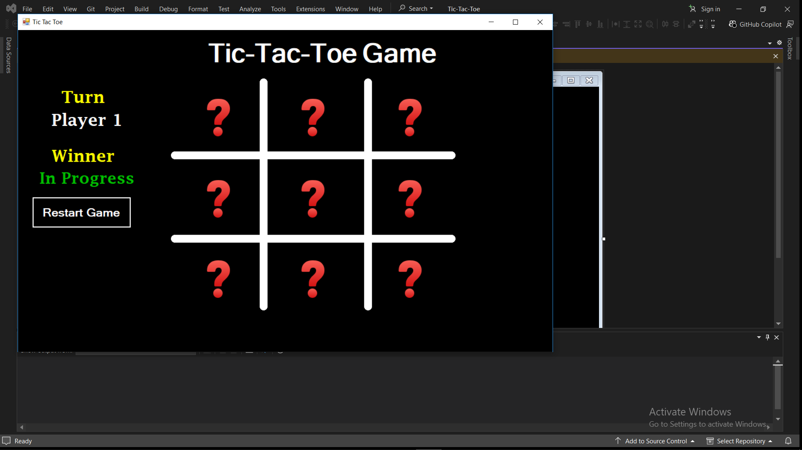
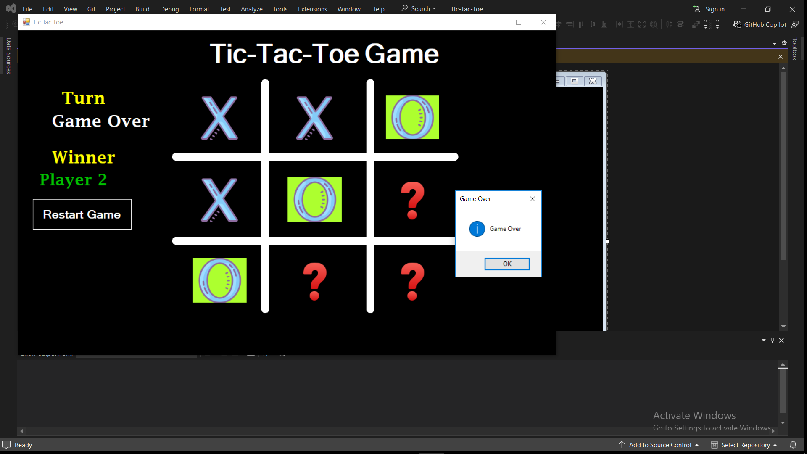
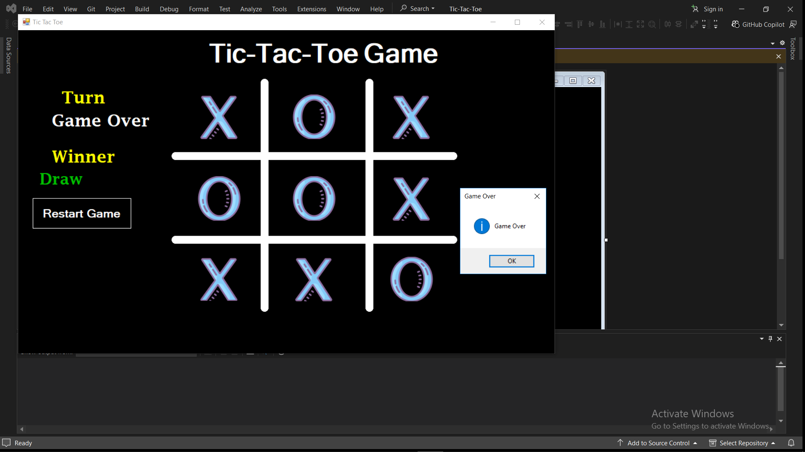

Tic-Tac-Toe | C# Windows Forms

A simple Tic-Tac-Toe game developed using C# and Windows Forms as part of my programming learning journey.

Features

- Two-player gameplay (X and O).
- Win detection (Horizontal, Vertical, and Diagonal).
- Draw detection.
- Game status tracking.
- New game functionality.

Technologies Used

- C#
- .NET Framework
- Windows Forms
- Visual Studio

Project Purpose

This project was developed to practice C# programming, Windows Forms, event handling, and implementing game logic.

## Screenshots

### Game Start

### Player 1 Wins

### Draw

